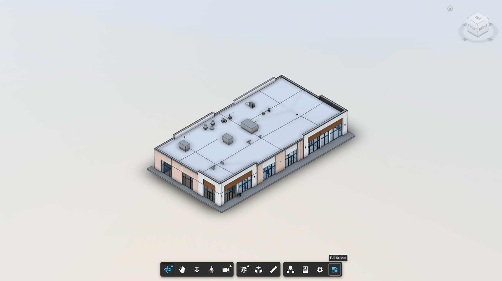

Full Screen mode hides the platform menus and shows only the model and the toolbar, giving you the largest possible view.

<Steps>
  <Step title="Select Full Screen">
    In the toolbar, click **Full Screen** (the last button).
  </Step>
  <Step title="Work in full screen">
    The viewer fills your entire screen. All toolbar tools remain available.

    <Frame caption="The 3D Viewer in full screen mode">
      
    </Frame>
  </Step>
  <Step title="Exit full screen">
    Click **Full Screen** again, or press **Esc** on your keyboard.
  </Step>
</Steps>

<Tip>
  Full Screen mode is ideal for presenting a model during a meeting or reviewing it on a large display.
</Tip>
