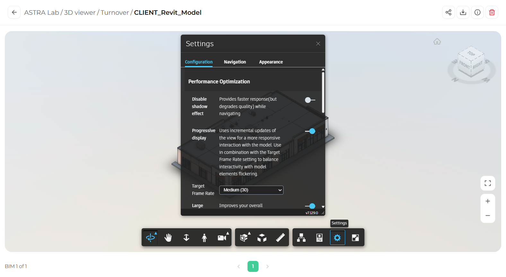

The Settings panel lets you adjust how the 3D Viewer performs, how navigation behaves, and how the model looks.

## Open Settings

In the toolbar, click **Settings** (the gear icon). The **Settings** panel opens.

<Frame caption="The Settings panel">
  
</Frame>

The panel has three tabs:

| Tab | What you can change |
|-----|---------------------|
| **Configuration** | Performance options that affect speed and visual quality. |
| **Navigation** | Options that control how the navigation tools behave. |
| **Appearance** | Options that control how the model is displayed. |

## Improve performance

If the viewer feels slow on your device, adjust these options in the **Configuration** tab under **Performance Optimization**:

| Setting | What it does |
|---------|--------------|
| **Disable shadow effect** | Gives a faster response while you navigate, with slightly lower visual quality. |
| **Progressive display** | Updates the view gradually for a smoother experience. Works together with Target Frame Rate. |
| **Target Frame Rate** | Balances smooth movement with how much of the model is drawn while you move. |

<Steps>
  <Step title="Open the Configuration tab">
    In the Settings panel, click **Configuration**.
  </Step>
  <Step title="Turn on Disable shadow effect">
    Click the switch next to **Disable shadow effect**.
  </Step>
  <Step title="Check Progressive display">
    Make sure **Progressive display** is turned on.
  </Step>
  <Step title="Test the result">
    Close the panel and navigate the model to check if it feels faster.
  </Step>
</Steps>

## Close Settings

Click the **X** in the top right corner of the panel. Your settings are applied right away.

<Tip>
  Large models with many elements benefit most from these performance options, especially on laptops.
</Tip>
