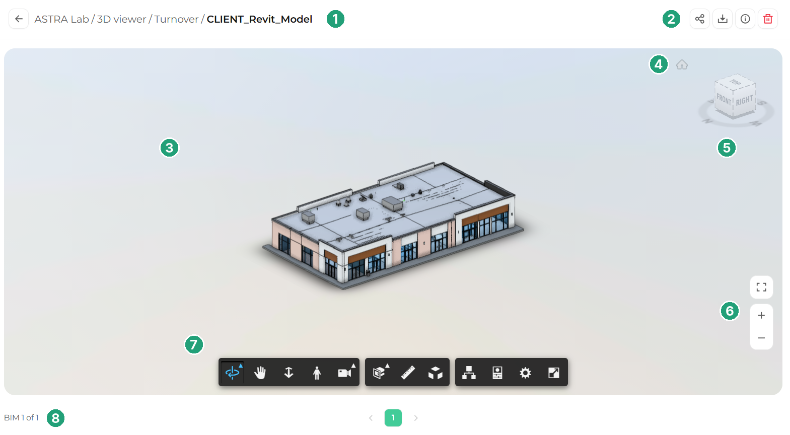
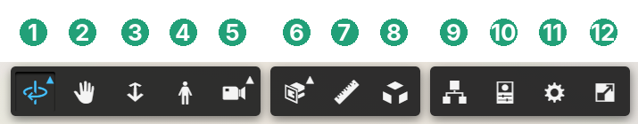

Before you start using the tools, take a minute to learn the main areas of the 3D Viewer.

<Frame caption="The main areas of the 3D Viewer">
  
</Frame>

| # | Area | What it does |  |
| --- | --- | --- | --- |
| 1 | **Path** | Shows the project, section, folder, and model you are viewing. Use the back arrow to return to the previous screen. |  |
| 2 | **Model actions** | Buttons to share, download, view details of, or delete the model. |  |
| 3 | **Viewing area** | The main space where the model is displayed and where you interact with it. |  |
| 4 | **Home** | Returns the model to its default view. |  |
| 5 | **ViewCube** | Lets you jump to standard views such as Top, Front, or Right. |  |
| 6 | **Expand and zoom buttons** | Expand the viewer, and zoom in or out with a single click. |  |
| 7 | **Toolbar** | All navigation and analysis tools. See the toolbar reference below. |  |
| 8 | **Model selector** | Shows which model you are viewing and lets you switch to other models in the same folder. |  |

<Warning>
  The delete button removes the model from the project. Only use it if you are sure, and check with your project admin if you are unsure.
</Warning>

## Toolbar reference

The toolbar at the bottom of the viewer is organized into three groups: navigation tools, analysis tools, and panels and settings.

<Frame caption="The 3D Viewer toolbar">
  
</Frame>

| # | Tool | What it does | Tutorial |
|---|------|--------------|----------|
| 1 | **Orbit** | Rotates the model around its center. | [Orbit, pan, and zoom](/3d-viewer/navigation/orbit-pan-zoom) |
| 2 | **Pan** | Moves the model across the screen. | [Orbit, pan, and zoom](/3d-viewer/navigation/orbit-pan-zoom) |
| 3 | **Zoom** | Moves the camera closer to or farther from the model. | [Orbit, pan, and zoom](/3d-viewer/navigation/orbit-pan-zoom) |
| 4 | **First Person** | Walks through the model at eye level. | [First person navigation](/3d-viewer/navigation/first-person) |
| 5 | **Camera Interactions** | Fit to view, focal length, and roll. | [Camera interactions](/3d-viewer/navigation/camera-interactions) |
| 6 | **Section Analysis** | Cuts through the model with planes or a box. | [Section analysis](/3d-viewer/tools/section-analysis) |
| 7 | **Measure** | Measures distances, angles, and coordinates. | [Measuring distances and angles](/3d-viewer/measure/distance-and-angle) |
| 8 | **Explode Model** | Separates model elements to show how they fit together. | [Explode model](/3d-viewer/tools/explode-model) |
| 9 | **Model Browser** | Lists every category and element in the model. | [Model browser](/3d-viewer/model-data/model-browser) |
| 10 | **Properties** | Shows the data of the selected element. | [Properties](/3d-viewer/model-data/properties) |
| 11 | **Settings** | Adjusts performance, navigation, and appearance. | [Viewer settings](/3d-viewer/display/viewer-settings) |
| 12 | **Full Screen** | Shows the viewer across your entire screen. | [Full screen mode](/3d-viewer/display/full-screen) |

<Tip>
  Hover over any toolbar button to see its name. Buttons with a small triangle in the corner contain more options. Click them to open the menu.
</Tip>
