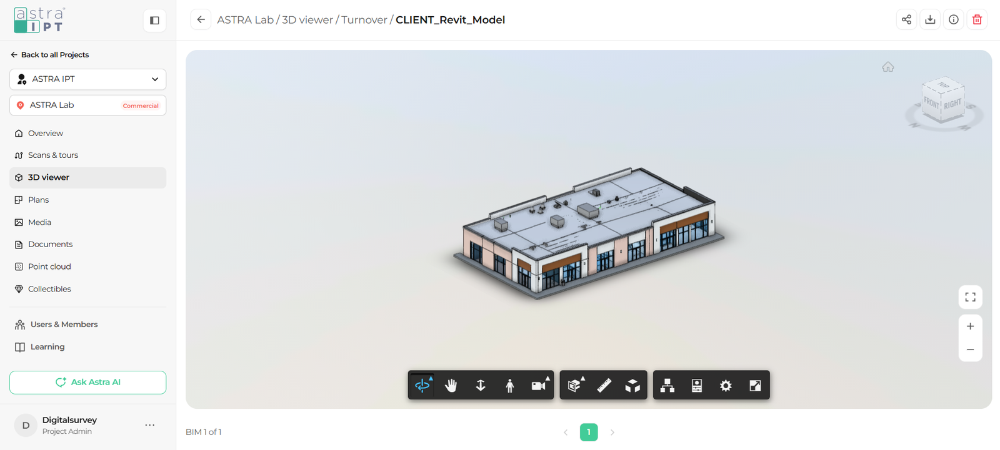

Every project in the ASTRA IPT platform has its own 3D Viewer section, where you can find the BIM models delivered for that project.

## Before you start

* You need access to a project that includes at least one BIM model.

## Open a model

<Steps>
  <Step title="Open your project">
    From the platform, select the project you want to work on. The project menu appears on the left side of the screen.
  </Step>
  <Step title="Go to the 3D viewer section">
    In the project menu, click **3D viewer**.
  </Step>
  <Step title="Select a model">
    Open the folder that contains your model and click the model name. The model loads in the viewer.

    <Frame caption="A BIM model open in the 3D Viewer">
      
    </Frame>
  </Step>
</Steps>

## Know where you are

The path at the top of the screen shows your current location, for example **ASTRA Lab / 3D viewer / Turnover / CLIENT_Revit_Model**. This tells you the project, the section, the folder, and the model you are viewing.

To go back to the previous screen, click the **back arrow** to the left of the path.

## Switch between models

When a folder contains more than one model, the bottom of the screen shows which model you are viewing (for example, **BIM 1 of 3**). Use the arrows or the page numbers below the viewer to move between models.

<Tip>
  Large models can take a few moments to load. If the model looks incomplete, wait a few seconds before you start navigating.
</Tip>

## What's next

<CardGroup cols={2}>
  <Card title="Interface tour" icon="map" href="/3d-viewer/get-started/interface-tour">
    Get to know every area of the viewer.
  </Card>
  <Card title="Orbit, pan, and zoom" icon="arrows-up-down-left-right" href="/3d-viewer/navigation/orbit-pan-zoom">
    Learn the basic navigation tools.
  </Card>
</CardGroup>
