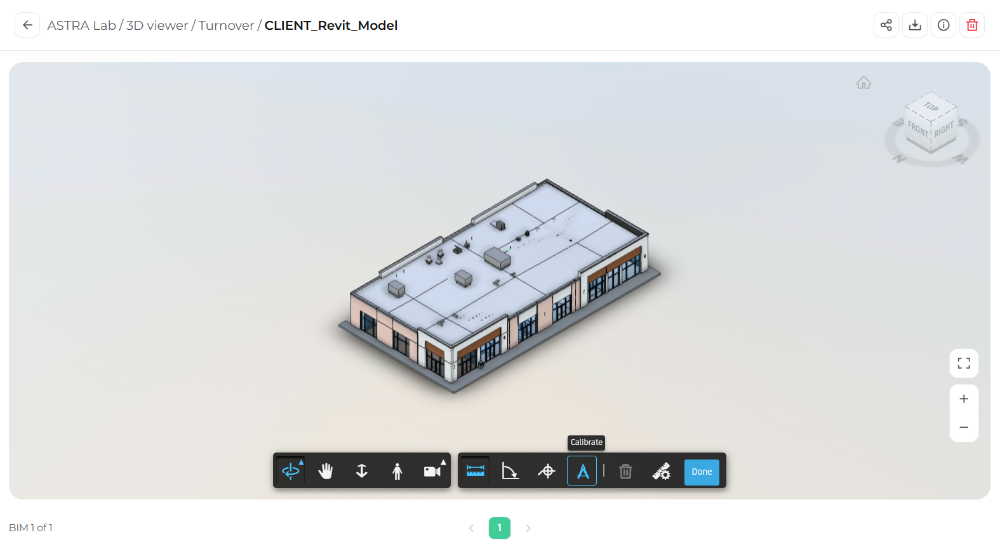

Calibrate lets you set the scale of your measurements using a distance you already know, such as a door width or a grid spacing. Once calibrated, all measurements follow the new scale.

<Steps>
  <Step title="Open the Measure tools">
    In the toolbar, click **Measure** (the ruler icon).
  </Step>
  <Step title="Select Calibrate">
    In the measure toolbar, click **Calibrate**.

    <Frame>
      
    </Frame>
  </Step>
  <Step title="Measure a known distance">
    Click the two end points of an element whose real size you know.
  </Step>
  <Step title="Enter the real value">
    Type the real distance and select its unit, then confirm. All measurements now use this calibration.
  </Step>
</Steps>

<Warning>
  Only calibrate when you are certain of the reference distance. An incorrect calibration affects every measurement you take afterwards.
</Warning>
