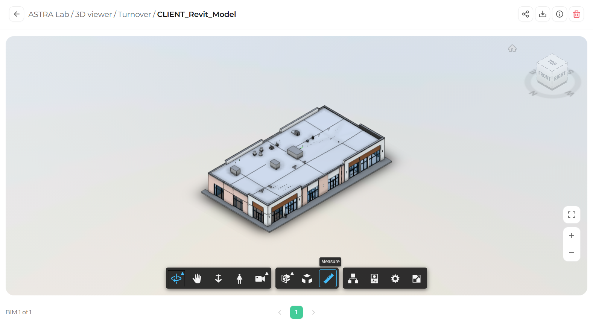
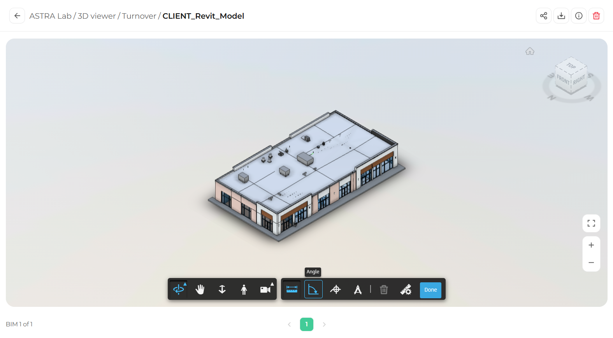
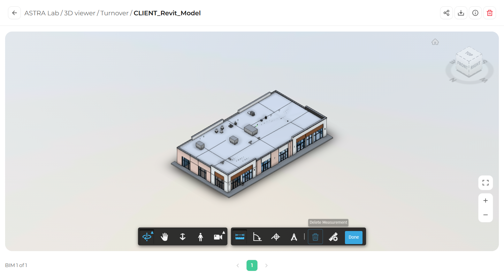

The Measure tool lets you measure distances and angles between points on the model, without leaving the viewer.

## Open the Measure tools

<Steps>
  <Step title="Select Measure">
    In the toolbar, click **Measure** (the ruler icon).

    <Frame>
      
    </Frame>
  </Step>
  <Step title="Use the measure toolbar">
    The right side of the toolbar changes to show the measure options: **Distance**, **Angle**, **Spot Coordinate**, **Calibrate**, **Delete Measurement**, **Measure Settings**, and **Done**.
  </Step>
</Steps>

## Measure a distance

<Steps>
  <Step title="Select Distance">
    In the measure toolbar, click **Distance** (the first option).

    <Frame>
      
    </Frame>
  </Step>
  <Step title="Click the first point">
    Hover over the model. The cursor snaps to edges, corners, and surfaces. Click to set the starting point.
  </Step>
  <Step title="Click the second point">
    Click the end point. The distance appears on the model.
  </Step>
</Steps>

## Measure an angle

<Steps>
  <Step title="Select Angle">
    In the measure toolbar, click **Angle** (the second option).

    <Frame>
      
    </Frame>
  </Step>
  <Step title="Click three points">
    Click the first point, then the corner of the angle, then the third point. The angle appears on the model.
  </Step>
</Steps>

## Delete a measurement

Click the measurement you want to remove, then click **Delete Measurement** (the trash icon) in the measure toolbar.

<Frame>
  
</Frame>

## Finish measuring

Click **Done** to close the measure tools and return to the normal toolbar.

<Tip>
  Zoom in close before you click. Small details are easier to snap to accurately when they fill more of the screen.
</Tip>

## What's next

<CardGroup cols={2}>
  <Card title="Spot coordinates" icon="crosshairs" href="/3d-viewer/measure/spot-coordinates">
    Find the exact coordinates of any point.
  </Card>
  <Card title="Measure settings" icon="sliders" href="/3d-viewer/measure/measure-settings">
    Change units and precision.
  </Card>
</CardGroup>
