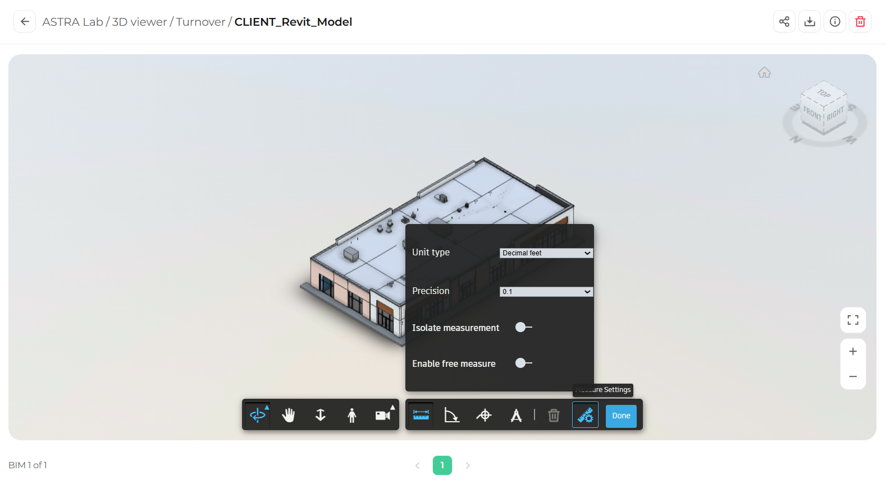

Measure Settings let you choose how measurements are displayed and how the Measure tool behaves.

<Steps>
  <Step title="Open the Measure tools">
    In the toolbar, click **Measure** (the ruler icon).
  </Step>
  <Step title="Open Measure Settings">
    In the measure toolbar, click **Measure Settings** (the icon to the left of **Done**). The settings panel opens.

    <Frame caption="The Measure Settings panel">
      
    </Frame>
  </Step>
  <Step title="Adjust the settings">
    Change any of the options described below. Changes apply right away.
  </Step>
</Steps>

## Available settings

| Setting | What it does |
|---------|--------------|
| **Unit type** | Sets the unit used to display measurements, for example decimal feet. |
| **Precision** | Sets how many decimal places are shown, for example 0.1. |
| **Isolate measurement** | When on, shows only the elements involved in the measurement so you can see it clearly. |
| **Enable free measure** | When on, lets you measure to any point, not only to snapped edges and corners. |

<Tip>
  Match the unit type and precision to your project drawings so your measurements are easy to compare.
</Tip>
