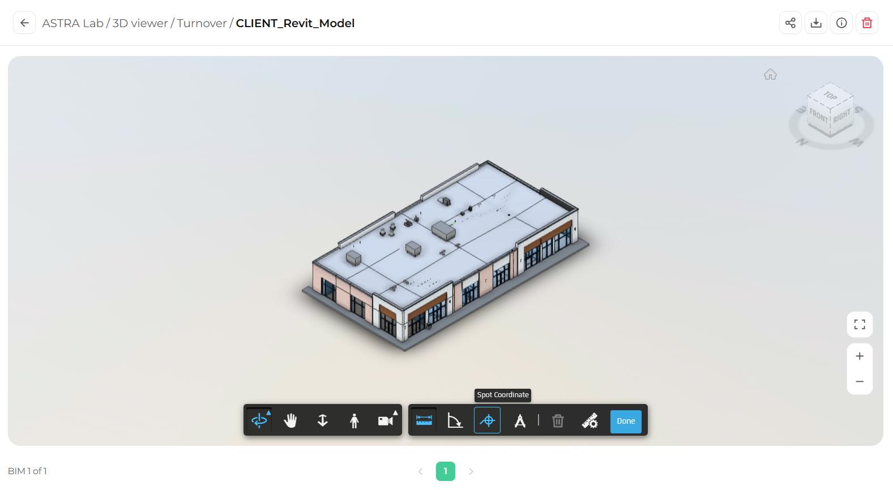

Spot Coordinate shows the X, Y, and Z coordinates of a point you select on the model. It is useful for checking positions and elevations.

<Steps>
  <Step title="Open the Measure tools">
    In the toolbar, click **Measure** (the ruler icon).
  </Step>
  <Step title="Select Spot Coordinate">
    In the measure toolbar, click **Spot Coordinate** (the crosshair icon).

    <Frame>
      
    </Frame>
  </Step>
  <Step title="Click a point">
    Click any point on the model. Its coordinates appear on screen.
  </Step>
  <Step title="Finish">
    Click **Done** when you are finished.
  </Step>
</Steps>

<Note>
  Coordinates use the unit type selected in [Measure settings](/3d-viewer/measure/measure-settings).
</Note>
