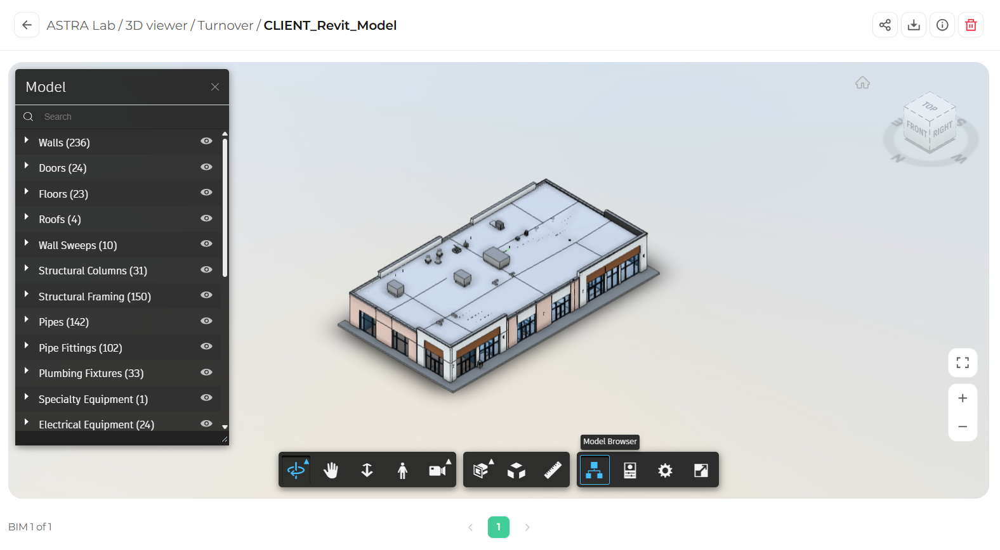

The Model Browser lists everything in the model, organized by category, such as walls, doors, floors, pipes, and electrical equipment. The number next to each category shows how many elements it contains.

## Open the Model Browser

In the toolbar, click **Model Browser**. The **Model** panel opens on the left side of the viewer.

<Frame caption="The Model Browser panel">
  
</Frame>

## Find an element

<Steps>
  <Step title="Search">
    Type a name in the **Search** box at the top of the panel. The list filters as you type.
  </Step>
  <Step title="Expand a category">
    Click the arrow next to any category to see the elements inside it.
  </Step>
  <Step title="Select an element">
    Click an element in the list to highlight it in the model.
  </Step>
</Steps>

## Show or hide categories

Click the **eye icon** next to a category or element to hide it from the model. Click the eye icon again to show it.

<Tip>
  Hide categories like roofs or ceilings to see inside the model without using a section. This is a quick way to review interior layouts and building systems.
</Tip>

## Close the Model Browser

Click the **X** in the top right corner of the panel. You can also drag the bottom right corner of the panel to resize it.

## What's next

<CardGroup cols={2}>
  <Card title="Properties" icon="list" href="/3d-viewer/model-data/properties">
    View the data behind any element.
  </Card>
  <Card title="Section analysis" icon="layer-group" href="/3d-viewer/tools/section-analysis">
    Cut through the model to see inside.
  </Card>
</CardGroup>
