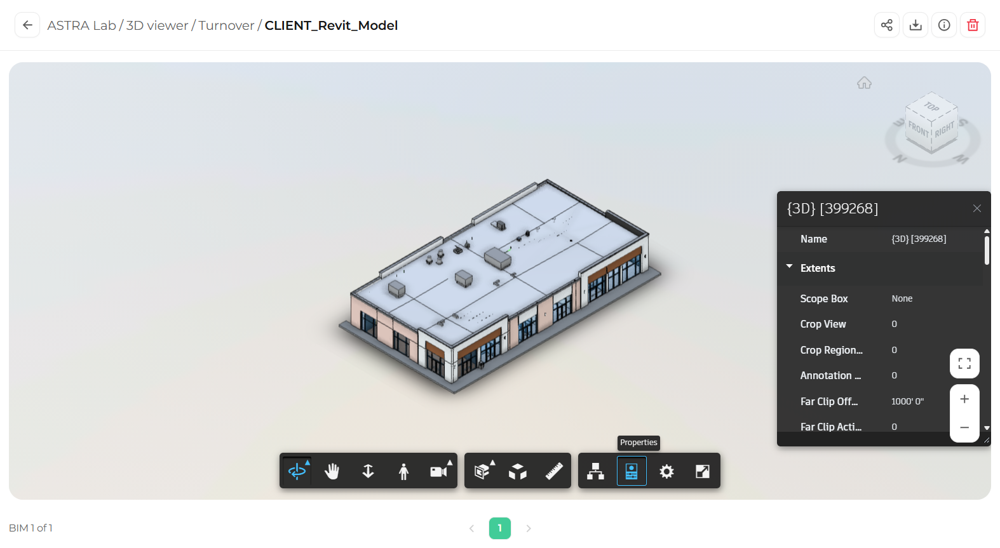

The Properties panel shows the information stored in the model for the element you select, such as its name, dimensions, materials, and other parameters.

## View the properties of an element

<Steps>
  <Step title="Select an element">
    Click any element in the model, or select it from the [Model browser](/3d-viewer/model-data/model-browser).
  </Step>
  <Step title="Open Properties">
    In the toolbar, click **Properties**. The panel opens on the right side of the viewer and shows the properties of the selected element.

    <Frame caption="The Properties panel">
      
    </Frame>
  </Step>
  <Step title="Review the information">
    Properties are organized in groups. Click the arrow next to a group name to expand or collapse it. Scroll down to see more.
  </Step>
</Steps>

<Note>
  If no element is selected, the panel shows the properties of the current model view.
</Note>

## Close the Properties panel

Click the **X** in the top right corner of the panel.

<Tip>
  Keep the Properties panel open while you click different elements. The panel updates automatically with each selection.
</Tip>
