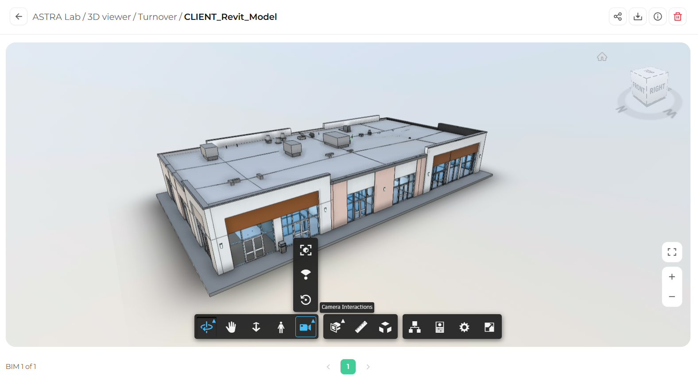
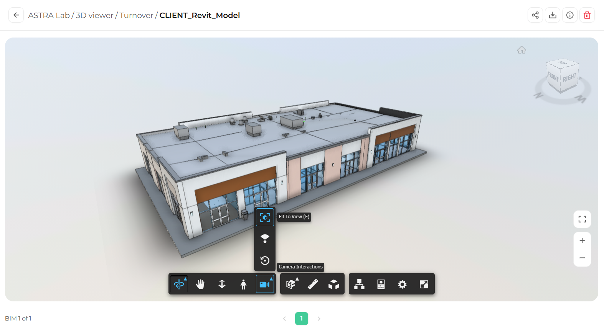
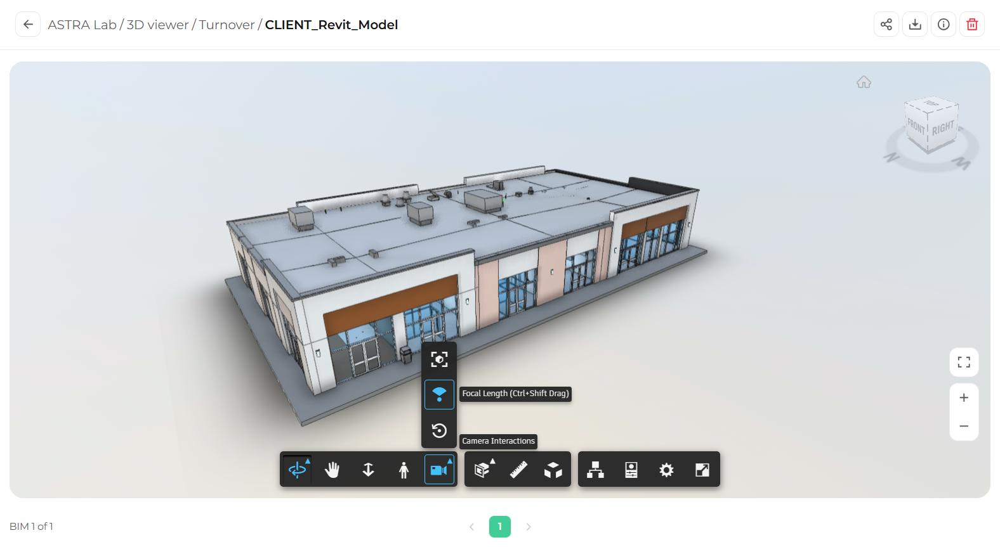
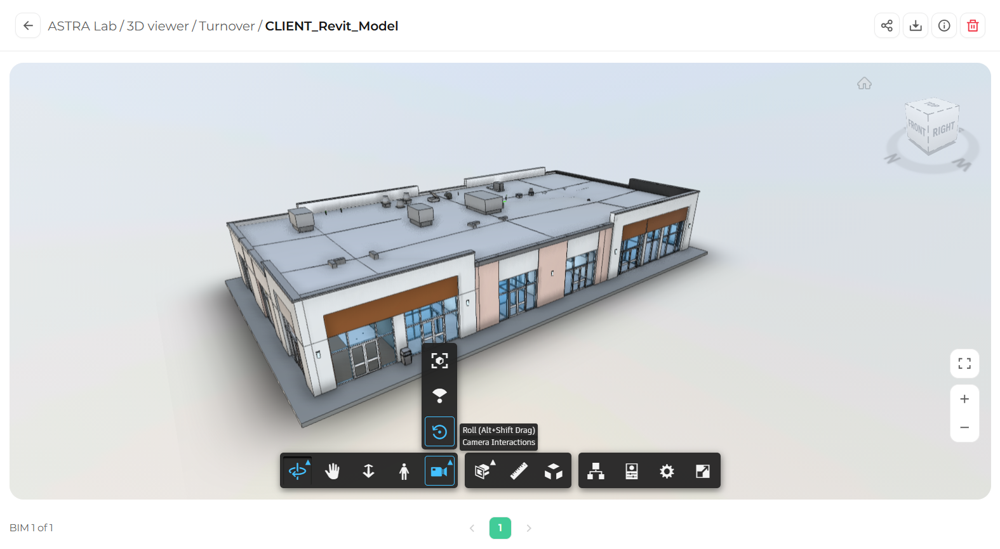

The Camera Interactions menu groups three tools that control how the camera frames the model.

## Open the Camera Interactions menu

In the toolbar, click **Camera Interactions** (the camera icon). A small menu opens above the button with three options.

<Frame caption="The Camera Interactions menu">
  
</Frame>

## Fit to View

Fit to View centers the model and zooms so the whole model fits on your screen.

<Steps>
  <Step title="Select Fit to View">
    In the Camera Interactions menu, click **Fit to View** (the top option).

    <Frame>
      
    </Frame>
  </Step>
  <Step title="Check the result">
    The camera moves so the entire model is visible.
  </Step>
</Steps>

<Tip>
  Press **F** on your keyboard to fit the model to view without opening the menu.
</Tip>

## Focal Length

Focal Length changes how wide the camera sees. A shorter focal length shows more of the model with a stronger sense of depth. A longer focal length shows less, with a flatter look.

<Steps>
  <Step title="Select Focal Length">
    In the Camera Interactions menu, click **Focal Length** (the middle option).

    <Frame>
      
    </Frame>
  </Step>
  <Step title="Adjust the focal length">
    Click and drag up or down in the viewing area until the view looks the way you want.
  </Step>
</Steps>

<Tip>
  Shortcut: hold **Ctrl** and **Shift** while you drag.
</Tip>

## Roll

Roll tilts the camera to the left or right around the direction you are looking.

<Steps>
  <Step title="Select Roll">
    In the Camera Interactions menu, click **Roll** (the bottom option).

    <Frame>
      
    </Frame>
  </Step>
  <Step title="Roll the camera">
    Click and drag in the viewing area to tilt the view.
  </Step>
</Steps>

<Tip>
  Shortcut: hold **Alt** and **Shift** while you drag.
</Tip>

<Note>
  If the view ends up tilted and you want to straighten it, click the **Home** icon above the ViewCube.
</Note>

## What's next

<CardGroup cols={2}>
  <Card title="Section analysis" icon="layer-group" href="/3d-viewer/tools/section-analysis">
    Cut through the model to see inside.
  </Card>
  <Card title="Measuring distances and angles" icon="ruler" href="/3d-viewer/measure/distance-and-angle">
    Take measurements directly on the model.
  </Card>
</CardGroup>
