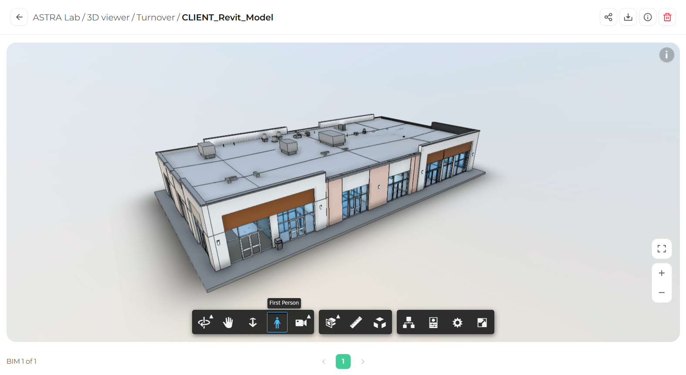
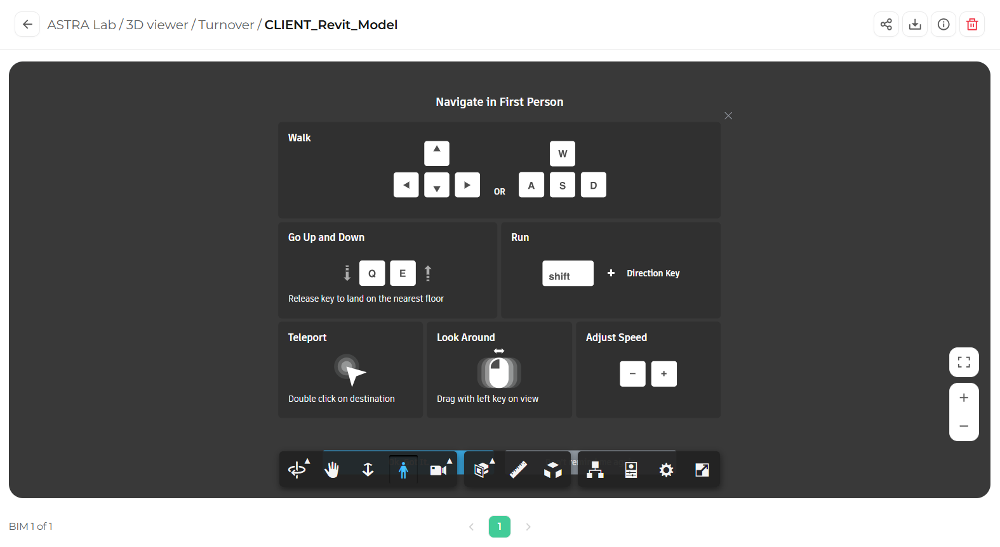

First Person mode lets you explore the model as if you were standing inside it. It is ideal for reviewing interior spaces, circulation routes, and sightlines.

## Start first person navigation

<Steps>
  <Step title="Select First Person">
    In the toolbar, click **First Person** (the icon of a person).

    <Frame>
      
    </Frame>
  </Step>
  <Step title="Review the controls">
    A panel called **Navigate in First Person** appears and shows all the controls. Read through them, then click the **X** in the top right corner of the panel to close it.

    <Frame caption="The first person controls panel">
      
    </Frame>
  </Step>
  <Step title="Start exploring">
    Use your keyboard to walk and your mouse to look around. The full list of controls is below.
  </Step>
</Steps>

## Controls

| Action | How to do it |
|--------|--------------|
| **Walk** | Use the arrow keys, or **W**, **A**, **S**, and **D** |
| **Go up and down** | Hold **Q** to go down and **E** to go up. Release the key to land on the nearest floor. |
| **Run** | Hold **Shift** while pressing a direction key |
| **Teleport** | Double click on the place you want to go |
| **Look around** | Click and drag with the left mouse button |
| **Adjust speed** | Use the **+** and **−** buttons in the controls panel |

<Tip>
  Teleport is the fastest way to move around large spaces. Double click on a doorway or a far wall to jump straight there.
</Tip>

## See the controls again

While First Person is active, an **i** icon appears in the top right corner of the viewer. Click it to open the controls panel again.

## Leave first person navigation

To go back to normal navigation, click **Orbit** in the toolbar.

## What's next

<CardGroup cols={2}>
  <Card title="Camera interactions" icon="video" href="/3d-viewer/navigation/camera-interactions">
    Fit to view, change the focal length, and roll the camera.
  </Card>
  <Card title="Keyboard shortcuts" icon="keyboard" href="/3d-viewer/reference/keyboard-shortcuts">
    All shortcuts in one place.
  </Card>
</CardGroup>
