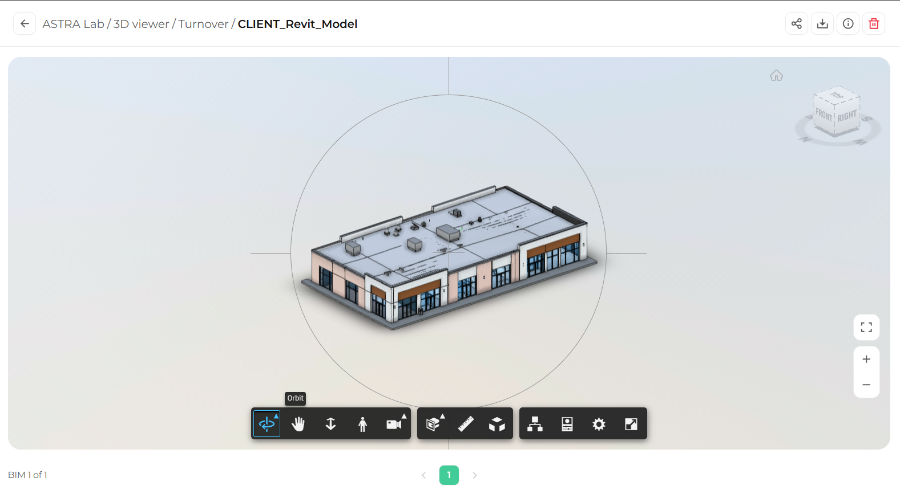
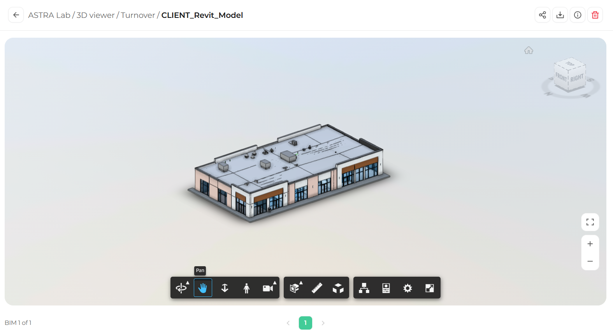
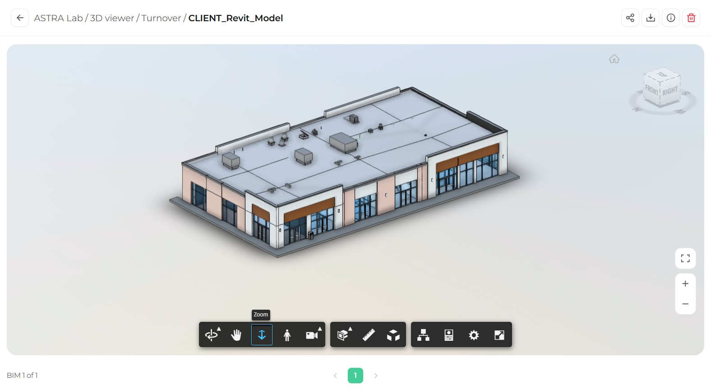

Orbit, Pan, and Zoom are the tools you will use most often. Together, they let you look at any part of the model from any angle. Each tool stays active until you choose another one.

## Orbit

Orbit rotates the model around its center so you can see it from every side. Orbit is the active tool when a model first opens.

<Steps>
  <Step title="Select Orbit">
    In the toolbar, click **Orbit** (the first button). The button turns blue when it is active.
  </Step>
  <Step title="Rotate the model">
    Click and drag in the viewing area. A circular guide appears to show the orbit. Drag left or right to turn the model, and up or down to tilt it.

    <Frame caption="The circular guide appears while you orbit">
      
    </Frame>
  </Step>
</Steps>

## Pan

Pan moves the model across the screen without rotating it. Use it to bring a specific area of the model to the center of your view.

<Steps>
  <Step title="Select Pan">
    In the toolbar, click **Pan** (the hand icon).

    <Frame>
      
    </Frame>
  </Step>
  <Step title="Move the model">
    Click and drag in the viewing area. The model follows your cursor.
  </Step>
</Steps>

## Zoom

Zoom moves the camera closer to or farther from the model.

<Steps>
  <Step title="Select Zoom">
    In the toolbar, click **Zoom** (the icon with two vertical arrows).

    <Frame>
      
    </Frame>
  </Step>
  <Step title="Zoom in or out">
    Click and drag up or down in the viewing area to move closer or farther away.
  </Step>
</Steps>

<Tip>
  You can also zoom at any time with your **mouse wheel**, or with the **+** and **−** buttons on the right side of the viewer, no matter which tool is active.
</Tip>

## Lost your view?

If the model moves out of sight, click the **Home** icon above the ViewCube to return to the default view, or press **F** to fit the whole model on screen.

## What's next

<CardGroup cols={2}>
  <Card title="ViewCube and Home" icon="cube" href="/3d-viewer/navigation/viewcube-and-home">
    Jump to standard views with one click.
  </Card>
  <Card title="First person navigation" icon="person-walking" href="/3d-viewer/navigation/first-person">
    Walk through the model at eye level.
  </Card>
</CardGroup>
