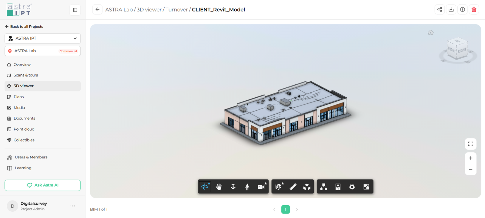

The ViewCube in the top right corner of the viewer shows which direction you are looking at the model from. You can also use it to jump instantly to standard views.

<Frame caption="The Home icon and the ViewCube in the top right corner">
  
</Frame>

## Jump to a standard view

<Steps>
  <Step title="Find the ViewCube">
    Look at the top right corner of the viewing area. Each face of the cube is labeled, for example **Top**, **Front**, and **Right**.
  </Step>
  <Step title="Click a face">
    Click any face of the cube to see the model straight on from that side. For example, click **Top** for a plan view.
  </Step>
  <Step title="Click an edge or corner for angled views">
    Click an edge or a corner of the cube to see the model from an angle that combines two or three sides.
  </Step>
</Steps>

The ring around the cube works like a compass. It helps you understand which direction the model is facing.

## Return to the default view

Click the **Home** icon (the small house above the ViewCube) at any time to return the model to the view it had when it first opened.

<Tip>
  Use Home whenever you feel lost in the model. It is the quickest way to start over without reloading the page.
</Tip>

## What's next

<CardGroup cols={2}>
  <Card title="First person navigation" icon="person-walking" href="/3d-viewer/navigation/first-person">
    Walk through the model at eye level.
  </Card>
  <Card title="Camera interactions" icon="video" href="/3d-viewer/navigation/camera-interactions">
    Fit to view, change the focal length, and roll the camera.
  </Card>
</CardGroup>
