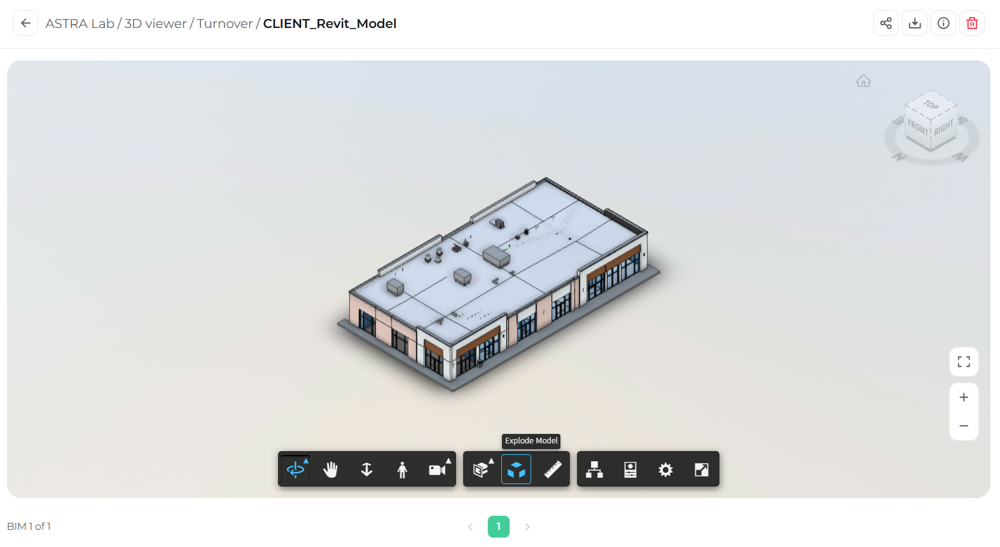

Explode Model spreads the elements of the model apart, like an exploded diagram. It helps you understand how the different parts of the model are assembled.

<Steps>
  <Step title="Select Explode Model">
    In the toolbar, click **Explode Model** (the icon of separated blocks).

    <Frame>
      
    </Frame>
  </Step>
  <Step title="Adjust the separation">
    Drag the slider that appears to control how far apart the elements move. Drag it back to bring the elements together again.
  </Step>
  <Step title="Explore the exploded view">
    Orbit and zoom to inspect the separated elements.
  </Step>
</Steps>

## Turn off Explode Model

Click **Explode Model** in the toolbar again to return the model to its normal state.

<Tip>
  Combine Explode Model with the [Model browser](/3d-viewer/model-data/model-browser) to hide categories you do not need and focus on specific elements.
</Tip>
