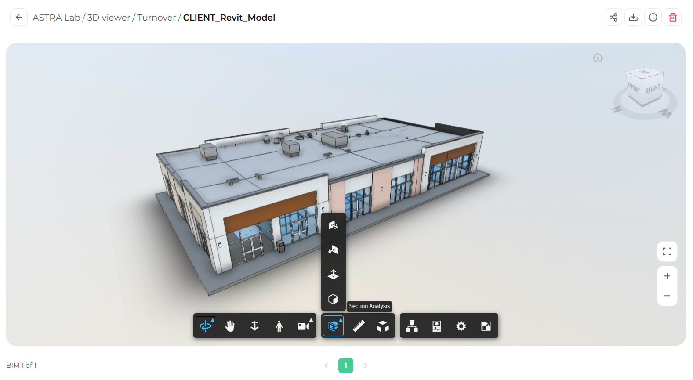
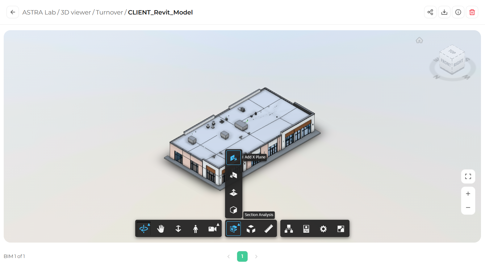
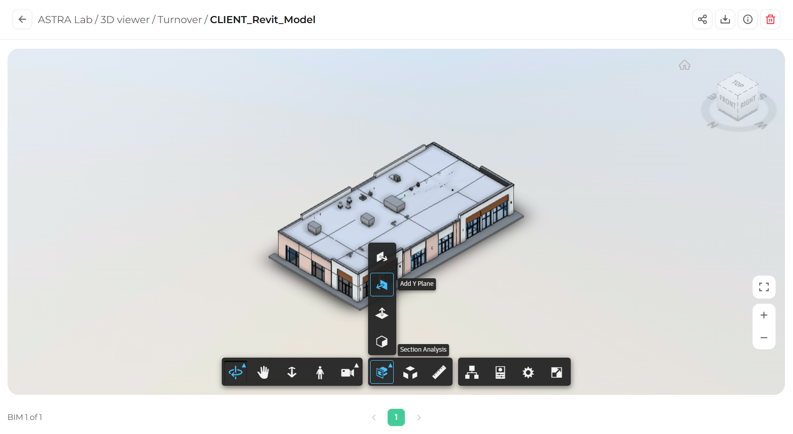
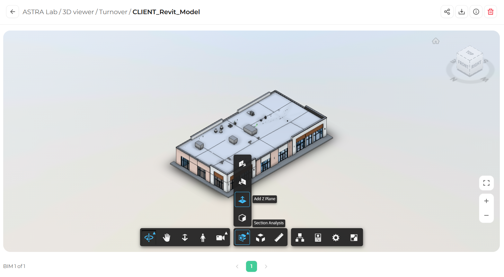
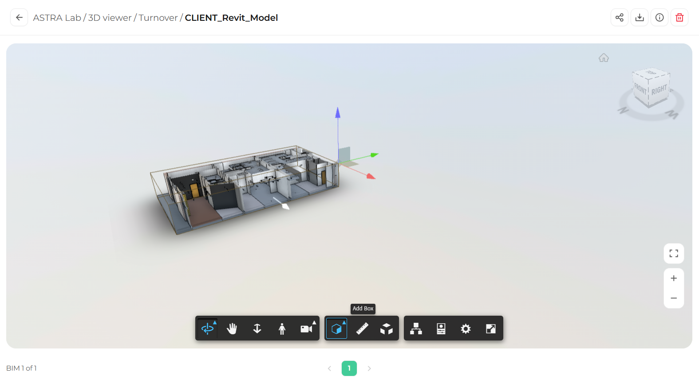

Section Analysis lets you slice through the model to reveal what is inside, such as rooms, structure, and building systems. You can cut along one direction with a section plane, or isolate an area with a section box.

## Open the Section Analysis menu

In the toolbar, click **Section Analysis**. A menu opens above the button with four options.

<Frame caption="The Section Analysis menu">
  
</Frame>

| Option | What it does |
|--------|--------------|
| **Add X Plane** | Cuts the model along the X axis |
| **Add Y Plane** | Cuts the model along the Y axis |
| **Add Z Plane** | Cuts the model horizontally, ideal for floor by floor views |
| **Add Box** | Surrounds an area with a box and hides everything outside it |

## Cut the model with a section plane

<Steps>
  <Step title="Choose a plane">
    In the Section Analysis menu, click **Add X Plane**, **Add Y Plane**, or **Add Z Plane**.

    <Tabs>
      <Tab title="X Plane">
        <Frame>
          
        </Frame>
      </Tab>
      <Tab title="Y Plane">
        <Frame>
          
        </Frame>
      </Tab>
      <Tab title="Z Plane">
        <Frame>
          
        </Frame>
      </Tab>
    </Tabs>
  </Step>
  <Step title="Move the plane">
    A plane with an arrow appears on the model. Click and drag the arrow to move the cut through the model.
  </Step>
  <Step title="Review the section">
    Orbit around the model to look at the cut from different angles.
  </Step>
</Steps>

<Tip>
  Use **Add Z Plane** and drag it down from the roof to see each floor of the model in plan.
</Tip>

## Isolate an area with a section box

<Steps>
  <Step title="Select Add Box">
    In the Section Analysis menu, click **Add Box**. A box appears around the model.
  </Step>
  <Step title="Resize the box">
    Click a face of the box to show the arrows. Drag the colored arrows to move that face in or out. Everything outside the box is hidden.

    <Frame caption="A section box showing the interior of the model">
      
    </Frame>
  </Step>
  <Step title="Explore the area">
    Orbit, pan, and zoom to inspect the space inside the box.
  </Step>
</Steps>

## Turn off the section

To remove the cut and see the full model again, click **Section Analysis** in the toolbar and click the active option again.

## What's next

<CardGroup cols={2}>
  <Card title="Explode model" icon="cubes" href="/3d-viewer/tools/explode-model">
    Separate elements to see how they fit together.
  </Card>
  <Card title="Measuring distances and angles" icon="ruler" href="/3d-viewer/measure/distance-and-angle">
    Measure inside the sectioned area.
  </Card>
</CardGroup>
