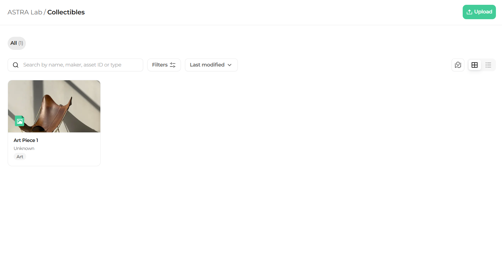
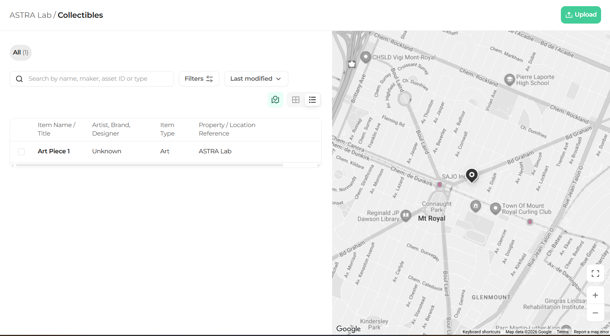

The Collectibles page has three views. Use the view buttons in the top right corner to switch between them.

## Grid view

Grid view shows every collectible as a card with its photo, name, artist, and category tag.

<Steps>
  <Step title="Select grid view">
    In the top right corner, click the grid view button.

    <Frame caption="Grid view">
      
    </Frame>
  </Step>
</Steps>

## List view

List view shows your collectibles in a table with the columns **Item Name / Title**, **Artist**, **Brand**, **Designer**, **Item Type**, and **Property / Location Reference**.

<Steps>
  <Step title="Select list view">
    In the top right corner, click the list view button.

    <Frame caption="List view">
      
    </Frame>
  </Step>
</Steps>

## Map view

Map view shows your collectibles on a map next to the list.

<Steps>
  <Step title="Select map view">
    In the top right corner, click the map view button.

    <Frame caption="Map view">
      
    </Frame>
  </Step>
</Steps>

<Tip>
  Use list view to compare many collectibles at a glance, and map view to see where your collectibles are located.
</Tip>

## What's next

<CardGroup cols={2}>
  <Card title="Search, filter, and sort" icon="magnifying-glass" href="/collectibles/search-filter-and-sort">
    Find any collectible in seconds.
  </Card>

  <Card title="Collectible details" icon="circle-info" href="/collectibles/collectible-details">
    Open a collectible and review its information.
  </Card>
</CardGroup>
