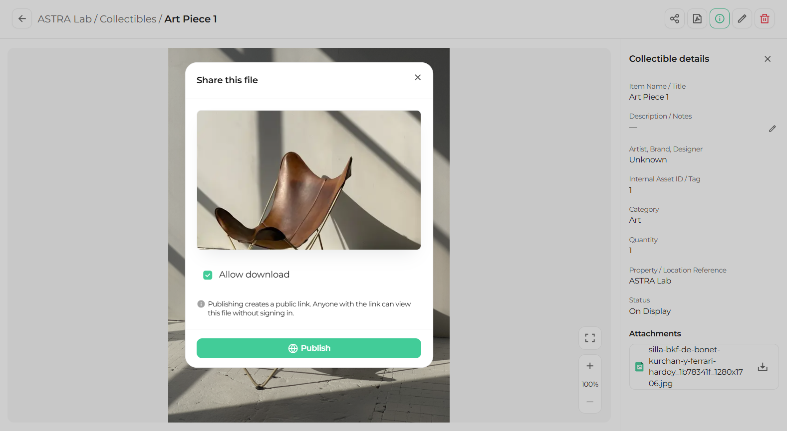
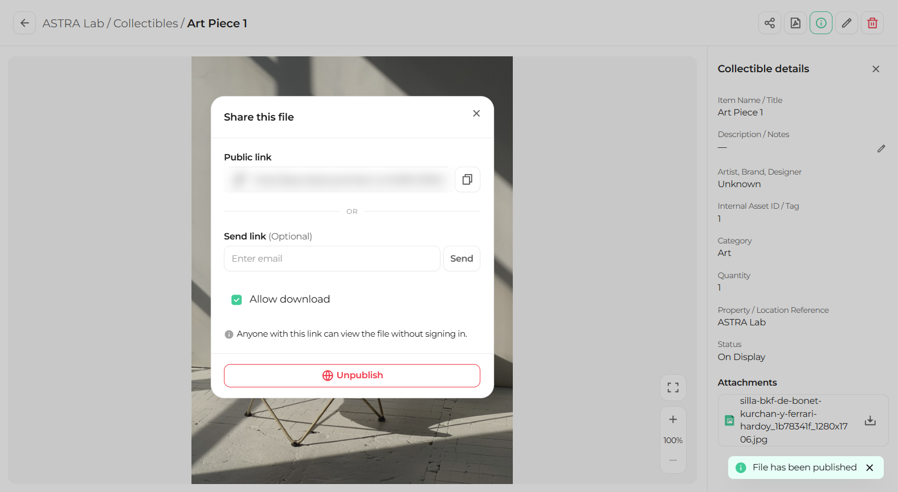

Share a collectible to create a public link. Anyone with the link can view the collectible without signing in to the platform.

## Publish a public link

<Steps>
  <Step title="Open the collectible">
    On the Collectibles page, click the collectible you want to share.
  </Step>
  <Step title="Click Share">
    At the top of the collectible, click **Share**. The **Share this file** window opens.

    <Frame>
      
    </Frame>
  </Step>
  <Step title="Choose the download option">
    Select **Allow download** if people with the link should be able to download the collectible.
  </Step>
  <Step title="Click Publish">
    Click **Publish** to create the public link.

    <Frame caption="The Share this file window before publishing">
      
    </Frame>
  </Step>
</Steps>

## Send the link

<Steps>
  <Step title="Copy the link">
    Copy the **Public link** and paste it wherever you need it.

    <Frame caption="The public link ready to copy or send">
      
    </Frame>
  </Step>
  <Step title="Or send it by email">
    Enter an email address and click **Send**.
  </Step>
</Steps>

<Warning>
  Anyone with the link can view the collectible without signing in. Share the link only with people who should see it.
</Warning>

<Tip>
  To stop sharing, open the **Share this file** window again and click **Unpublish**. The link stops working.
</Tip>

## What's next

<CardGroup cols={2}>
  <Card title="Export to PDF" icon="file-pdf" href="/collectibles/export-to-pdf">
    Download a one page summary of a collectible.
  </Card>

  <Card title="Delete a collectible" icon="trash" href="/collectibles/delete-a-collectible">
    Remove a collectible from your project.
  </Card>
</CardGroup>
