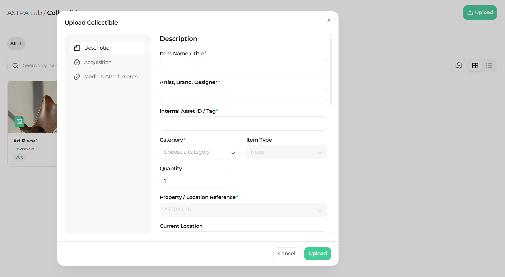
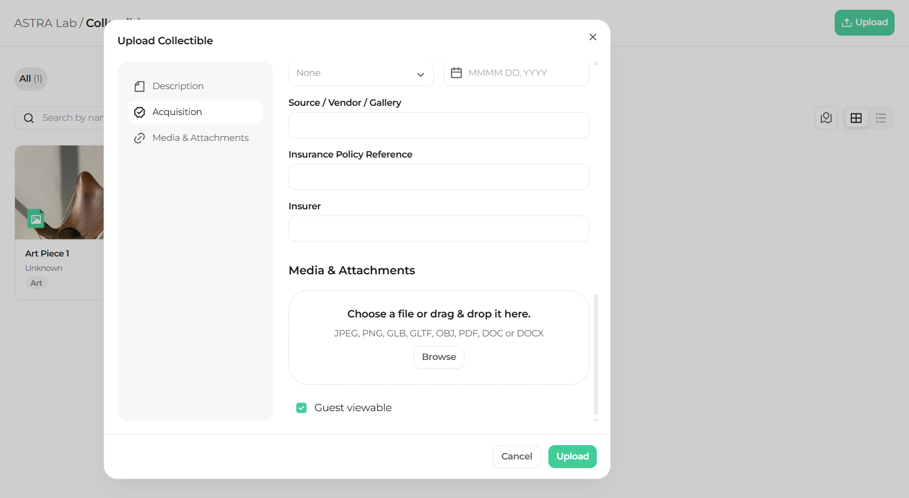

Uploading a collectible creates a new record in your project. The **Upload Collectible** window has three sections on the left: **Description**, **Acquisition**, and **Media & Attachments**. Required fields are marked with an asterisk (\*).

## Open the upload window

<Steps>
  <Step title="Click Upload">
    On the Collectibles page, click the green **Upload** button in the top right corner. The **Upload Collectible** window opens.
  </Step>
</Steps>

## Fill in the description

<Steps>
  <Step title="Open Description">
    On the left side of the window, click **Description**.

    <Frame caption="The Description section of the Upload Collectible window">
      
    </Frame>
  </Step>
  <Step title="Enter the item information">
    Enter the **Item Name / Title\***, and if you know them, the **Artist** and **Brand**. Then enter the **Designer\***.
  </Step>
  <Step title="Enter the asset ID">
    Enter the **Internal Asset ID / Tag\***.
  </Step>
  <Step title="Choose the category">
    Choose a **Category\***, then choose the **Item Type**.
  </Step>
  <Step title="Enter the quantity and location">
    Enter the **Quantity**, the **Property / Location Reference\***, and the **Current Location**.
  </Step>
</Steps>

## Fill in the acquisition data

<Steps>
  <Step title="Open Acquisition">
    On the left side of the window, click **Acquisition**.

    <Frame caption="The Acquisition section of the Upload Collectible window">
      
    </Frame>
  </Step>
  <Step title="Enter how it was acquired">
    Enter the **Acquisition Method**, the **Acquisition Date**, and the **Source / Vendor / Gallery**.
  </Step>
  <Step title="Enter the insurance data">
    Enter the **Insurance Policy Reference** and the **Insurer**.
  </Step>
</Steps>

## Add media and attachments

<Steps>
  <Step title={"Open Media & Attachments"}>
    On the left side of the window, click **Media & Attachments**.

    <Frame caption={"The Media & Attachments section of the Upload Collectible window"}>
      
    </Frame>
  </Step>
  <Step title="Add your files">
    Drag and drop your files into the upload area, or click **Browse** to choose them from your computer.
  </Step>
  <Step title="Choose who can see the files">
    Select **Guest viewable** if guests should be able to see the files.
  </Step>
  <Step title="Save the collectible">
    Click **Upload** to save the collectible. To close the window without saving, click **Cancel**.
  </Step>
</Steps>

<Tip>
  Accepted file types are JPEG, PNG, GLB, GLTF, OBJ, PDF, DOC, and DOCX. Add a clear photo so the collectible is easy to recognize on its card.
</Tip>

<Warning>
  You cannot save the collectible until every required field marked with an asterisk (\*) is filled in.
</Warning>

## What's next

<CardGroup cols={2}>
  <Card title="Collectible details" icon="circle-info" href="/collectibles/collectible-details">
    Open a collectible and review its information.
  </Card>

  <Card title="Edit a collectible" icon="pen" href="/collectibles/edit-a-collectible">
    Update the information of a collectible.
  </Card>
</CardGroup>
